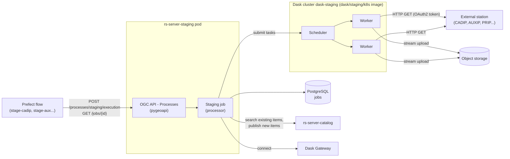

# Staging internals

This page describes how the [staging](../users/staging.md) is implemented by **rs-server-staging**.

## Two Docker images

The staging uses two different Docker images, both built by the rs-server CI:

| Image | Role | Deployment |
|---|---|---|
| `rs-server-staging` | The web service: [OGC API - Processes](https://ogcapi.ogc.org/processes/) endpoints implemented with [pygeoapi](https://pygeoapi.io/), jobs stored in a PostgreSQL database, orchestration of the staging tasks. | A Kubernetes deployment, with the other rs-server services. |
| `dask/staging/k8s` (`dask/staging/local` in local mode) | The Dask scheduler and workers that execute the copy tasks. They contain the `rs_server_staging` and `rs_server_common` packages, so the workers can run their functions. | A Dask cluster created through Dask Gateway, labelled `dask-staging`, kept running by the `dask-cluster-staging` application of [rs-server-deployment](https://github.com/RS-PYTHON/rs-server-deployment/blob/develop/README.md). |

The web service is the **client** of the Dask cluster: it connects to the cluster through Dask Gateway (with a
JupyterHub API token), then submits the tasks to the scheduler, that distributes them to the workers. The Python
and Dask versions of the service and of the Dask images must be the same (see
[Dask images](https://github.com/RS-PYTHON/rs-workflow-env/blob/develop/docs/dask_images.md)).

## Sequence

1. The service checks the `execute` right of the user, creates a job in the database and returns its identifier.
   The rest of the processing is asynchronous.
2. The job resolves the input items (from the request body, or by calling the given URL), searches the catalog to
   find the items that are already staged, and keeps the others (or the expired ones).
3. For each station, it checks the `staging_download` right of the user, loads the station configuration, and gets
   an OAuth2 token, refreshed automatically during the job.
4. It computes the target bucket and path of each asset (`s3://<bucket>/<owner>/<collection>/...`) from the
   [bucket configuration](https://github.com/RS-PYTHON/rs-documentation/blob/develop/docs/administration/update-rs-server.md#object-storage-buckets-and-data-lifecycle).
5. It connects to the Dask cluster and submits one task per asset: each task streams the file from the station to
   the object storage, and reports its progress.
6. When all the tasks are completed, it publishes the items in the catalog, with their assets referencing the object
   storage, and updates the job status. If a task fails, the job fails and the files already copied are deleted.

The OpenTelemetry trace context is propagated to the Dask tasks, so the whole staging can be followed in Grafana.

## Local mode

In local mode, there is no Dask Gateway in the cluster: the `dask/staging/local` image runs its own Dask Gateway
server, and the service connects to it with a basic authentication (see
[Dask images](https://github.com/RS-PYTHON/rs-workflow-env/blob/develop/docs/dask_images.md)).
