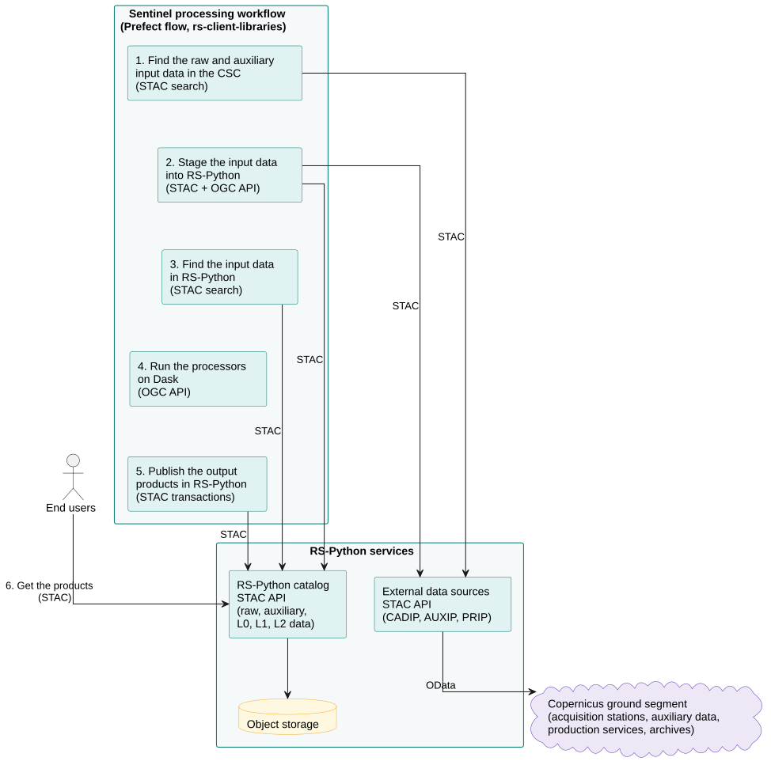
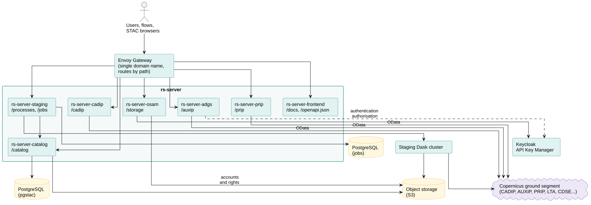

# rs-server

**rs-server** is the central service of the RS-Python platform. It exposes the core functionalities through a
unified REST API, protected by authentication and fine-grained authorisation. It:

- provides access to the **external data sources**: the Copernicus acquisition stations (CADIP), auxiliary data
  (AUXIP) and production services (PRIP), see [External data sources](users/external-data-sources.md),
- provides a **catalog** of the products, see [Catalog](users/catalog.md),
- **stages** the products of the external data sources into the catalog, see [Staging](users/staging.md),
- manages the **object storage** accounts and access rights of the users, see [OSAM](users/osam.md),
- aggregates the documentation of all these services in a single **Swagger page**, see [Frontend](users/frontend.md).

The processing of the products is provided by a separate service,
[rs-dpr-service](https://github.com/RS-PYTHON/rs-dpr-service/blob/develop/docs/doc/index.md), that is not part of this
repository because it uses different Python and Dask versions.

| | |
|---|---|
| Source code | <https://github.com/RS-PYTHON/rs-server> |
| Swagger page | <https://rspy.ops.rs-python.eu/docs> on the reference platform |
| Python API documentation | `rs_server_*` modules in the [Python API documentation](https://github.com/RS-PYTHON/rs-documentation/blob/develop/docs/developers/python-api.md) |
| Deployment | [Helm charts](https://github.com/RS-PYTHON/rs-helm/blob/develop/README.md), [rs-server-deployment](https://github.com/RS-PYTHON/rs-server-deployment/blob/develop/README.md) |
| Developer manual | [Developer manual](dev/developer_manual.md) |

## STAC everywhere

All the data is described with the [SpatioTemporal Asset Catalog (STAC)](https://stacspec.org/) specification, and
searched with the [STAC API](https://github.com/radiantearth/stac-api-spec): the data of the external data sources,
that rs-server translates from [OData](https://www.odata.org/) to STAC, and the data of the catalog. The same
language is used at each step of a processing workflow:

Using STAC brings several advantages:

- **Interoperability**: STAC is an open, widely adopted standard, also used by the
  [Copernicus Data Space Ecosystem](https://documentation.dataspace.copernicus.eu/APIs/STAC.html) and by the
  [EOPF](https://eopf.copernicus.eu/) products. RS-Python data is compatible with many external tools, libraries and
  platforms, see the [STAC ecosystem](https://stacspec.org/en/about/tools-resources/).
- **Uniform data model**: all the datasets, internal or external, are described with the same structure, which
  simplifies their discovery and integration.
- **Efficient search**: STAC provides powerful spatial, temporal and metadata-based search capabilities, with
  [CQL2](https://docs.ogc.org/is/21-065r2/21-065r2.html) filters.
- **Easier integration**: developers use existing STAC clients and tools, e.g.
  [pystac-client](https://pystac-client.readthedocs.io/) or [STAC Browser](https://github.com/radiantearth/stac-browser),
  instead of building custom parsers or interfaces.
- **Scalability**: STAC is designed to handle large catalogs and distributed data sources.

The asynchronous services (staging, processing) follow the [OGC API - Processes](https://ogcapi.ogc.org/processes/)
standard: a process is started with a `POST /processes/{process}/execution` request, that returns a job identifier,
and the job is followed with `GET /jobs/{job_id}`.

## Architecture

rs-server is made of independent web services, implemented with [FastAPI](https://fastapi.tiangolo.com/), each one
packaged in its own Docker image and deployed with its own [Helm chart](https://github.com/RS-PYTHON/rs-helm/blob/develop/README.md):

| Service | Endpoints | Implementation |
|---|---|---|
| `rs-server-adgs` | `/auxip` | STAC API over the AUXIP stations (ADGS). |
| `rs-server-cadip` | `/cadip` | STAC API over the CADIP stations. |
| `rs-server-prip` | `/prip` | STAC API over the PRIP stations. |
| `rs-server-catalog` | `/catalog` | [stac-fastapi-pgstac](https://github.com/stac-utils/stac-fastapi-pgstac) with a [pgstac](https://github.com/stac-utils/pgstac) database, wrapped by RS-Python middlewares for the ownership, the authorisation, the object storage and the data lifecycle. |
| `rs-server-staging` | `/processes`, `/jobs` | [pygeoapi](https://pygeoapi.io/) process manager, with the staging tasks run on a Dask cluster. |
| `rs-server-osam` | `/storage` | Object storage accounts and rights management. |
| `rs-server-frontend` | `/docs`, `/openapi.json` | Aggregated Swagger page. |

The services are stateless and scale horizontally. They are exposed behind a single domain name by the
[Envoy Gateway](https://gateway.envoyproxy.io/) of the cluster, that routes the requests by path. They share the
`rs_server_common` package: authentication and authorisation, STAC API common implementation, OData to STAC
mapping, S3 access, logging and [OpenTelemetry](https://opentelemetry.io/) instrumentation.

rs-server runs in two modes:

- **cluster mode**, on a Kubernetes cluster, with authentication: each request must carry a Keycloak OAuth2
  session cookie or an API key, and the user must have the required [Keycloak roles](https://github.com/RS-PYTHON/rs-documentation/blob/develop/docs/getting-started/user-rights.md),
- **local mode**, with Docker Compose, without authentication, for development purposes, see the
  [local mode](https://github.com/RS-PYTHON/rs-demo/blob/develop/docs/local-mode.md).

## User documentation

- [External data sources](users/external-data-sources.md) and their [STAC mapping](users/stac-mapping.md)
- [Catalog](users/catalog.md) and its [data model and lifecycle](users/data-model.md)
- [Staging](users/staging.md)
- [OSAM](users/osam.md)
- [Frontend](users/frontend.md)
