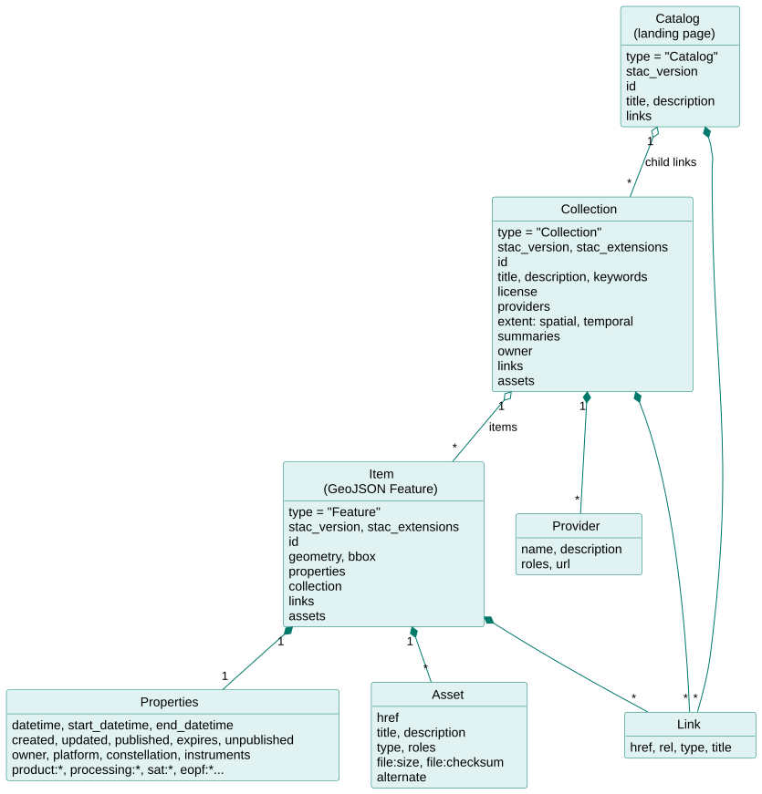
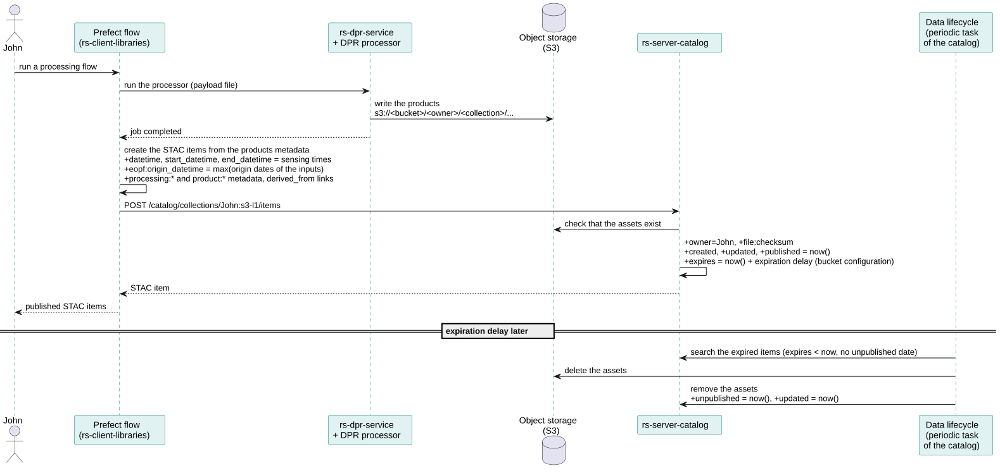
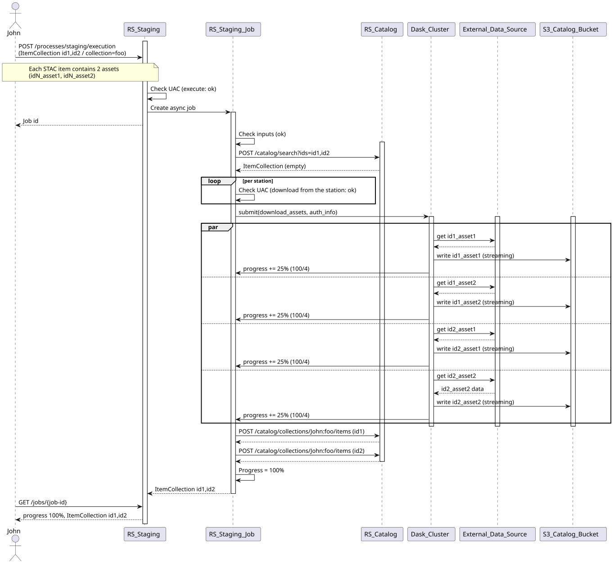

# Catalog data model and lifecycle

All the business data of RS-Python (CADIP sessions, auxiliary files, Level-0, Level-1 and Level-2 products) is
described with the [SpatioTemporal Asset Catalog (STAC)](https://stacspec.org/) specification, version 1.1.0. This
page describes the STAC fields used for the data, both the static ones (set once) and the dynamic ones, that evolve
during the data lifecycle.

## Data model

- The landing page of the catalog is a STAC **Catalog**, that links to the **Collections** you can read.
- Each collection belongs to an **owner** (see [Collections and ownership](catalog.md#collections-and-ownership))
  and contains **Items**.
- Each item is a [GeoJSON](https://geojson.org/) Feature that describes a product: its footprint (`geometry`,
  `bbox`), its metadata (`properties`) and its files (`assets`), stored in the S3 object storage.

The fields are defined by the STAC specification:

| Object | Specification |
|---|---|
| Catalog | [Catalog fields](https://github.com/radiantearth/stac-spec/blob/master/catalog-spec/catalog-spec.md#catalog-fields) |
| Collection | [Collection fields](https://github.com/radiantearth/stac-spec/blob/master/collection-spec/collection-spec.md#collection-fields), including the [providers](https://github.com/radiantearth/stac-spec/blob/master/commons/common-metadata.md#provider) and the spatial and temporal extents |
| Item | [Item fields](https://github.com/radiantearth/stac-spec/blob/master/item-spec/item-spec.md#item-fields) and [common metadata](https://github.com/radiantearth/stac-spec/blob/master/commons/common-metadata.md) (`title`, `description`, `license`, `platform`, `constellation`, `instruments`, `gsd`...) |
| Asset | [Asset fields](https://github.com/radiantearth/stac-spec/blob/master/commons/assets.md) (`href`, `title`, `type`, `roles`...) |

### Extensions

The items also use fields from the following STAC extensions:

| Extension | Prefix | Description |
|---|---|---|
| [Product](https://github.com/stac-extensions/product) | `product:` | Product type (mandatory in the catalog, e.g. `S03OLCEFR`), timeliness. |
| [Processing](https://github.com/stac-extensions/processing) | `processing:` | Processing level, facility, software version, date and lineage of the product. |
| [Satellite](https://github.com/stac-extensions/sat) | `sat:` | Orbit numbers and state, acquisition station. |
| [SAR](https://github.com/stac-extensions/sar) | `sar:` | Instrument mode, polarisations... of the Sentinel-1 products. |
| [Electro-Optical](https://github.com/stac-extensions/eo) | `eo:` | Bands, cloud and snow cover of the optical products. |
| [Projection](https://github.com/stac-extensions/projection) | `proj:` | Coordinate reference system and grid of the products. |
| [Raster](https://github.com/stac-extensions/raster) | `raster:` | Raster bands of the assets. |
| [EOPF](https://github.com/CS-SI/eopf-stac-extension) | `eopf:` | Fields specific to the EOPF products, e.g. `eopf:datatake_id`, `eopf:origin_datetime`. |
| [File](https://github.com/stac-extensions/file) | `file:` | Size and checksum of the assets. The checksum is always an MD5 multihash, see [Add an item](catalog.md#add-an-item). |
| [Timestamps](https://github.com/stac-extensions/timestamps) | | `published`, `expires`, `unpublished` dates, see [Data lifecycle](#data-lifecycle). |
| [External IDs](https://github.com/stac-extensions/external-ids) | | `externalIds` of the items and assets: their identifiers in other systems, e.g. the OData `Id` in the external data sources, see [STAC mapping](stac-mapping.md), or the UUID of the [OData PRIP interface](odata-mapping.md#product-identifier). |
| [Alternate Assets](https://github.com/stac-extensions/alternate-assets) | | Alternate locations of an asset, e.g. its download URL. |
| [Authentication](https://github.com/stac-extensions/authentication) | `auth:` | How to authenticate to get the assets. |
| [Ownership](https://github.com/RS-PYTHON/ownership-stac-extension) (RS-Python) | | `owner` of the collections and items. |
| [CADIP](https://github.com/RS-PYTHON/cadip-stac-extension) (RS-Python) | `cadip:` | Metadata of the CADIP sessions and files, see [STAC mapping](stac-mapping.md#cadip). |

The products generated by the DPR processors may contain fields of other extensions, as written by the processors.
The list of the extensions declared by the catalog is configured at deployment time (`rs_server_catalog.extensions`
inventory variable).

## Data lifecycle

### Item lifecycle

The lifecycle of the items is handled with these dynamic fields:

| Field | Meaning | CADIP sessions | AUXIP auxiliary files | S1, S2, S3 products |
|---|---|---|---|---|
| `start_datetime` | Data capture start | `DownlinkStart` of the session | Validity start (`ContentDate/Start`) | Sensing start, written by the processor |
| `datetime` | Data capture, by ESA convention the start | `PublicationDate` of the session | Validity start | Sensing start |
| `end_datetime` | Data capture end | `DownlinkStop` of the session | Validity end (`ContentDate/End`) | Sensing stop |
| `eopf:origin_datetime` | Availability of the product at its source | | `PublicationDate` | For the generated products, the most recent origin date of the input products, set by the processing flows |
| `processing:datetime` | Processing date | | `processingDate` | Set by the processor |
| `created` | First insertion in the catalog | Set by the catalog | Set by the catalog | Set by the catalog |
| `updated` | Last modification in the catalog | Set by the catalog | Set by the catalog | Set by the catalog |
| `published` | Publication in the catalog | Set by the catalog | Set by the catalog | Set by the catalog |
| `expires` | Data valid until | Set by the catalog: insertion date + expiration delay | idem | idem |
| `unpublished` | Data removed (assets deleted) | Set by the catalog data lifecycle task | idem | idem |

All the dates are formatted according to [RFC 3339](https://www.rfc-editor.org/rfc/rfc3339#section-5.6). When these
fields are set in the item properties, they refer to the metadata (e.g. when the STAC item was published); when
they are set in an asset, they refer to the file itself.

### Expiration and deletion

The expiration delay of an item is given by the [bucket configuration](https://github.com/RS-PYTHON/rs-documentation/blob/develop/docs/administration/update-rs-server.md#object-storage-buckets-and-data-lifecycle),
according to its owner, collection and product type. It allows e.g. to keep the auxiliary files much longer than
the intermediate products.

The catalog runs a periodic task (`RSPY_DATA_LIFECYCLE_PERIOD`) that, for each item whose `expires` date is passed
and that is not unpublished yet:

1. deletes its assets from the object storage,
2. removes the assets from the item,
3. sets its `unpublished` and `updated` dates to the current date.

The item metadata is kept in the catalog, so the history of the production is not lost. An unpublished item can be
published again by staging or generating it again.

### Staging lifecycle

The items of the external data sources enter the catalog through the [staging](staging.md):

