# External data sources

The external data sources services allow to search, in read-only mode, the data available in the
[Copernicus](https://sentinels.copernicus.eu/) ground segment. The Copernicus services expose their data with the
[OData](https://www.odata.org/) protocol: rs-server translates the [STAC API](https://github.com/radiantearth/stac-api-spec)
requests of the users into OData requests, and the OData responses into STAC items (see
[STAC mapping of external data](stac-mapping.md)). The users only deal with STAC.

To copy the data into the RS-Python object storage and catalog, use the [staging](staging.md).

| Service | Endpoint | Data | Swagger section |
|---|---|---|---|
| [CADIP](#cadip-stations) | `/cadip` | Raw data sessions of the acquisition stations | [CADIP stations](https://rspy.ops.rs-python.eu/docs#/CADIP%20stations) |
| [AUXIP](#auxip-adgs-instances) | `/auxip` | Auxiliary data | [ADGS stations](https://rspy.ops.rs-python.eu/docs#/ADGS%20stations) |
| [PRIP](#prip-instances) | `/prip` | Level-0, Level-1 and Level-2 products of the production services | [PRIP stations](https://rspy.ops.rs-python.eu/docs#/PRIP%20stations) |

All of them implement the same STAC API endpoints (landing page, collections, items, search, queryables,
sortables), described in [Browse products](https://github.com/RS-PYTHON/rs-documentation/blob/develop/docs/services/browse-products.md).
Each user only sees the stations for which they have the `rs_<service>_<station>_read` role, see
[User rights](https://github.com/RS-PYTHON/rs-documentation/blob/develop/docs/getting-started/user-rights.md#external-data-sources).

## CADIP stations

The [CADU Interface delivery Point (CADIP)](https://sentiwiki.copernicus.eu/web/copernicus-operations) is the
interface of the Copernicus acquisition ground stations. It delivers the raw data (CADU, Channel Access Data Unit)
downlinked by the satellites, organised in **sessions**: a session contains the data acquired during one pass of a
satellite over a station, split into several files (DSDB files) per channel.

rs-server maps each CADIP **session** to a STAC item (identified by its session ID, e.g.
`S1A_20170501121534062343`) and each **file** of the session to a STAC asset. The metadata of the sessions are
described by the [CADIP STAC extension](https://github.com/RS-PYTHON/cadip-stac-extension) (`cadip:` prefix).

Getting the items of a collection requires two requests to the station: one to get the sessions, one to get their
files:

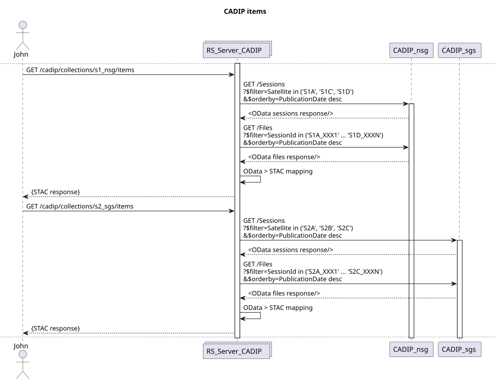

## AUXIP (ADGS) instances

The [Auxiliary Data Gathering Service (ADGS)](https://sentiwiki.copernicus.eu/web/copernicus-operations#CopernicusOperations-AuxiliaryDataGathering)
delivers the auxiliary data files used by the processors (orbit files, meteorological data, calibration files...)
through an AUXIP (AUXiliary data Interface delivery Point) interface. rs-server maps each auxiliary file to a STAC
item with a single asset, identified by the file name without its extension.

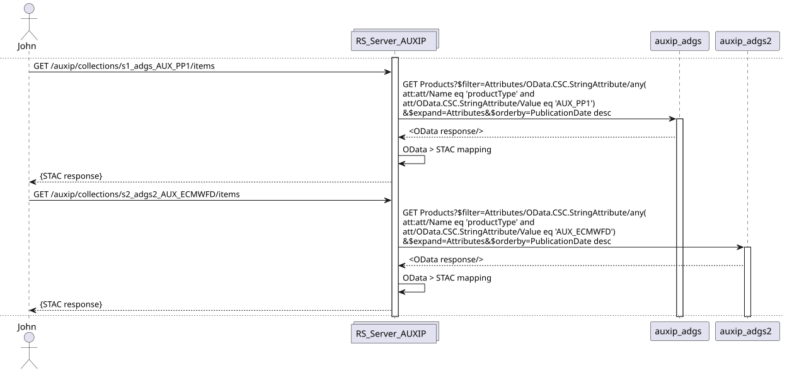

## PRIP instances

The [Production service Interface delivery Point (PRIP)](https://sentiwiki.copernicus.eu/web/copernicus-operations#CopernicusOperations-SystematicProduction)
is the interface of the Copernicus production services, one per satellite. It delivers the Level-0, Level-1 and
Level-2 products. rs-server maps each product to a STAC item with a single asset, and converts the legacy product
types to the EOPF product types (e.g. `IW_SLC__1S` to `S01SIWSLC`) with the
[product type mapping](https://github.com/RS-PYTHON/rs-server/blob/develop/services/common/config/product_type_mapping.yaml).

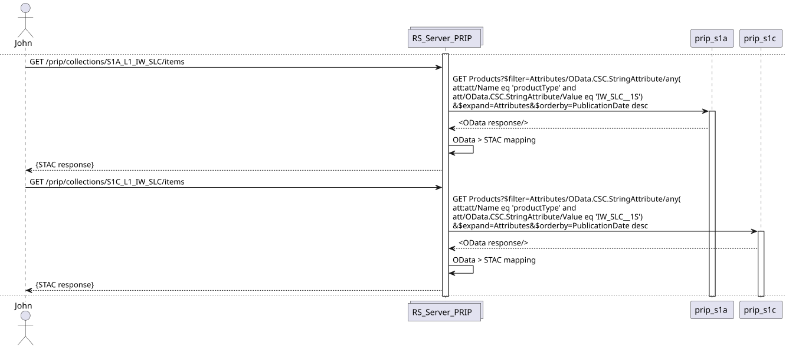

## Other data sources

| Data source | Access |
|---|---|
| [Copernicus Data Space Ecosystem (CDSE)](https://dataspace.copernicus.eu/) | Its public [STAC API](https://documentation.dataspace.copernicus.eu/APIs/STAC.html) is called directly by the [rs-client-libraries](https://github.com/RS-PYTHON/rs-client-libraries/blob/develop/docs/doc/index.md) (`CdseClient`), e.g. to find auxiliary data. Its products can be staged from its S3 object storage. |
| [EarthDataHub](https://earthdatahub.destine.eu/) of [Destination Earth](https://destination-earth.eu/) | Its public STAC API is called directly by the rs-client-libraries (`EarthDataHubClient`), e.g. to find the Copernicus Digital Elevation Model. |
| Long Term Archive (LTA), European Data Relay System (EDRS) | Not exposed by rs-server. The [mockups](https://github.com/RS-PYTHON/rs-testmeans/blob/develop/README.md) of the LTA are available for the tests. |

## Collections

The collections of the stations are **virtual**: they are not stored in a database, but defined in the
configuration of rs-server, to give a view of the content of a station. A collection can contain e.g. all the
sessions of a CADIP station, or only the products of a given type from a PRIP instance. They are defined in the
`*_search_config.yaml` files of the services (e.g. in the
[rs-server-prip Helm chart](https://github.com/RS-PYTHON/rs-helm/tree/develop/charts/rs-server-prip/config) for the
cluster mode):

```yaml
collections:
- id: S1A_L0_IW_RAW          # collection identifier
  station: s1a               # station that contains the data, as configured in the station secrets
  query:                     # optional OData filter, to select a subset of the station data
    productType: IW_RAW__0N
  title: Sentinel-1A IW RAW products from the PRIP
  description: ...
  license: other
  extent: ...                # usual STAC collection fields
  links: ...
  providers: ...
```

The `/<service>/collections` endpoint only returns the collections of the stations that you are allowed to read.

## Access to the stations

The URLs and credentials of the stations are set by the administrators in the `rs-server-station-secrets`
configuration (see [Update rs-server parameters](https://github.com/RS-PYTHON/rs-documentation/blob/develop/docs/administration/update-rs-server.md)).
rs-server gets an OAuth2 token from each station and keeps it up to date:

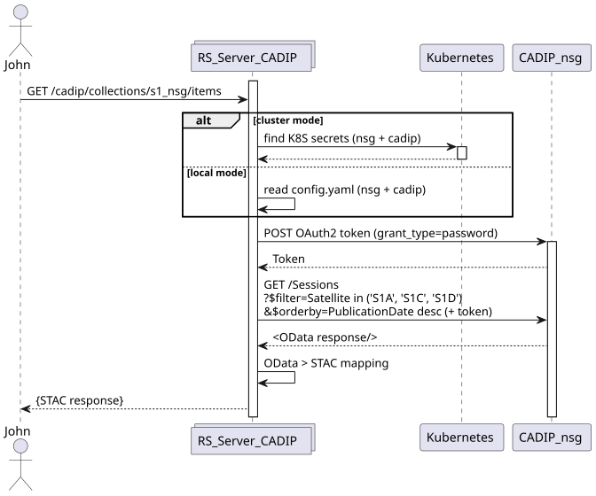

On the development and test platforms, the stations are replaced by the
[mockups of rs-testmeans](https://github.com/RS-PYTHON/rs-testmeans/blob/develop/README.md).

## Search across several stations

A search on several collections or stations (`/<service>/search`) sends one OData request per station, then
aggregates and paginates the results:

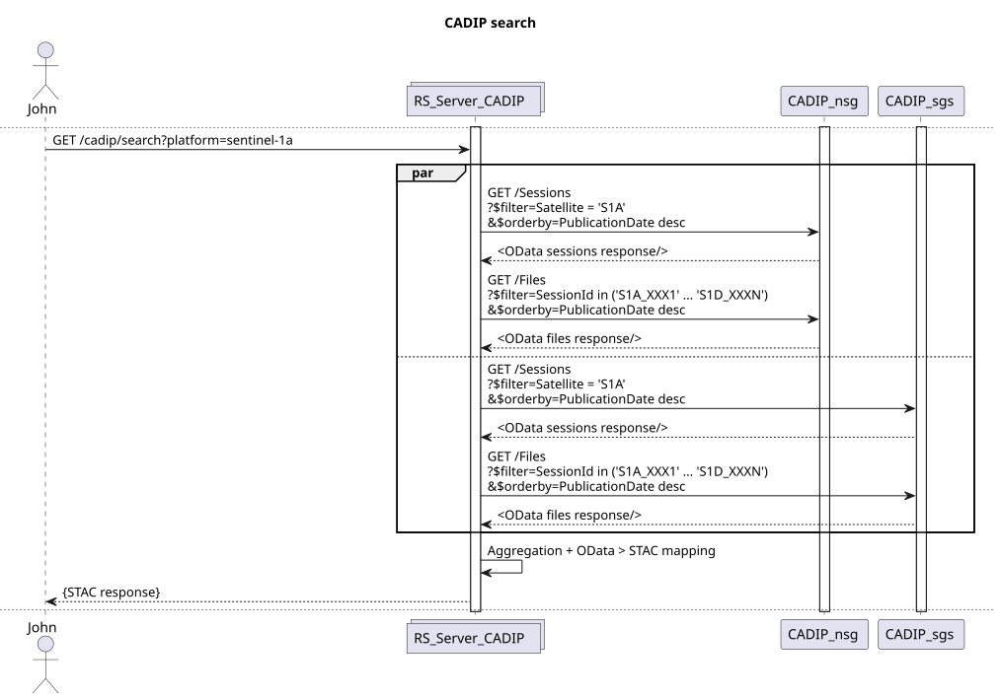

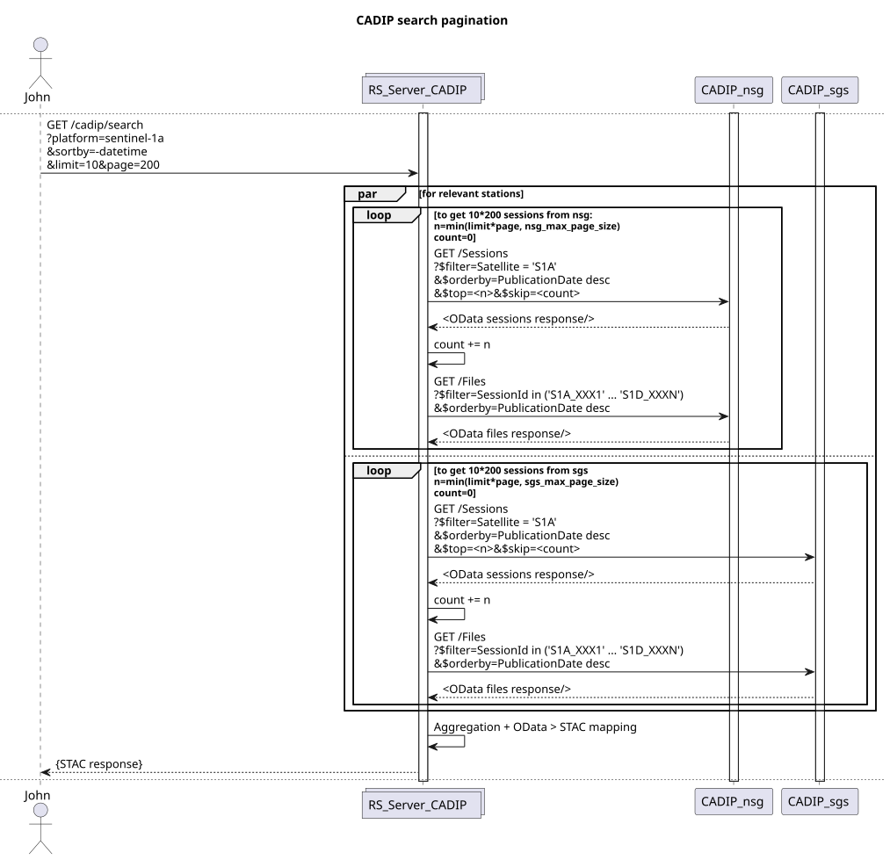

The landing page, collections and queryables requests are answered from the configuration:

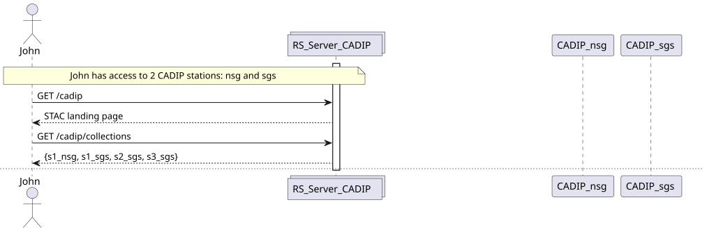

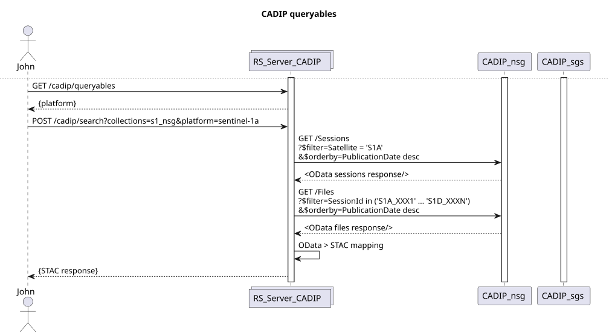

The AUXIP and PRIP services behave the same way:

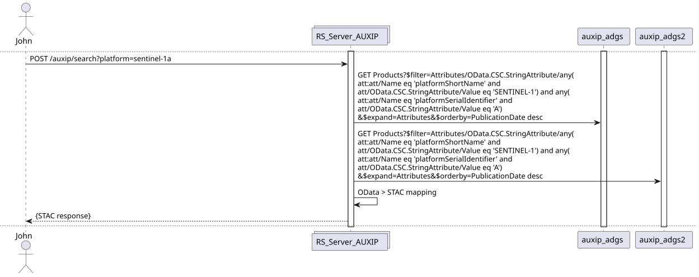

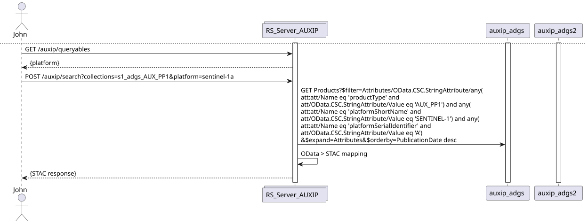

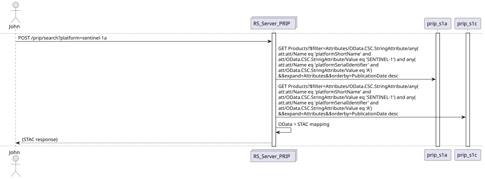
