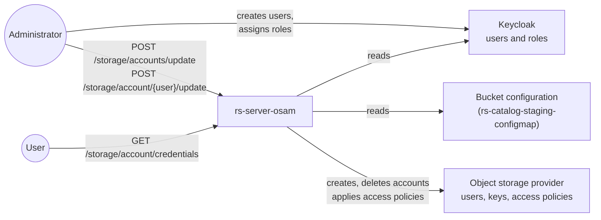

# OSAM (Object Storage Access Manager)

The products are downloaded directly from the S3 object storage, so the access rights to the object storage must be
managed for each user. This is the role of **rs-server-osam** (Object Storage Access Manager): it keeps the
permissions of each user consistent between:

- the authorisation to access a STAC collection of the catalog, given by the Keycloak roles
  (`rs_catalog_<owner>:<collection>_<read|write|download>`, see
  [User rights](https://github.com/RS-PYTHON/rs-documentation/blob/develop/docs/getting-started/user-rights.md#catalog)),
- the authorisation to access the corresponding bucket and folder in the object storage.

By automating this alignment, OSAM removes tedious manual operations and prevents inconsistencies in the object
storage access rights.

## Endpoints

| Method | Endpoint | Description | Role |
|---|---|---|---|
| `GET` | `/storage/account/credentials` | Return your personal S3 credentials: `access_key`, `secret_key`, `endpoint` and `region`. | Any authenticated user |
| `POST` | `/storage/accounts/update` | Synchronise the object storage accounts with the Keycloak accounts: create an object storage account for each new Keycloak user, delete the accounts of the deleted users. Runs in the background. | `rs_osam_update` |
| `POST` | `/storage/account/{user}/update` | Compute the object storage rights of a user from their Keycloak roles and the bucket configuration, and apply them as an access policy. | `rs_osam_update` |

The synchronisation also runs periodically (twice a day by default, see the `app.bucketConfig.defaultOsamFrequencySync`
value of the [rs-server-osam Helm chart](https://github.com/RS-PYTHON/rs-helm/blob/develop/charts/rs-server-osam/README.md)),
and can be started from Prefect with the `Synchronize OSAM Accounts` and `Update OSAM Account` deployments (see
[Common flows](https://github.com/RS-PYTHON/rs-client-libraries/blob/develop/docs/doc/flows/common-flows.md#operation-flows)).

## How the rights are computed

The objects are stored in the buckets under `<bucket>/<owner>/<collection>/`. The bucket of a collection is given by
the [bucket configuration](https://github.com/RS-PYTHON/rs-documentation/blob/develop/docs/administration/update-rs-server.md#object-storage-buckets-and-data-lifecycle),
a CSV table with the columns `owner, collection, product type, expiration delay, bucket`.

For each catalog role of the user, `rs_catalog_<owner>:<collection>_<right>`, OSAM finds the lines of the bucket
configuration that match the owner and the collection (`*` and [shell-style wildcards](https://docs.python.org/3/library/fnmatch.html)
are supported), and grants access to the `<bucket>/<owner>/<collection>/` folders:

| Catalog right | Object storage access |
|---|---|
| `read` | List the objects. |
| `download` | List and read the objects. |
| `write` | List, read, write and delete the objects. |

In addition, each user gets all the rights on their own folder, `<bucket>/<user>/*/`, of the default bucket
(the bucket of the `*, *, *` line).

The bucket configuration is also served to the other rs-server services on an internal endpoint, not exposed
outside the cluster.

## Configuration

OSAM needs:

- an OpenID Connect client in Keycloak, to read the users and their roles,
- the credentials of the object storage provider API, to manage the users and their access policies. The reference
  platform uses [OVHcloud](https://www.ovhcloud.com/) object storage.

These parameters are set in the [rs-server-osam Helm chart](https://github.com/RS-PYTHON/rs-helm/blob/develop/charts/rs-server-osam/README.md).
